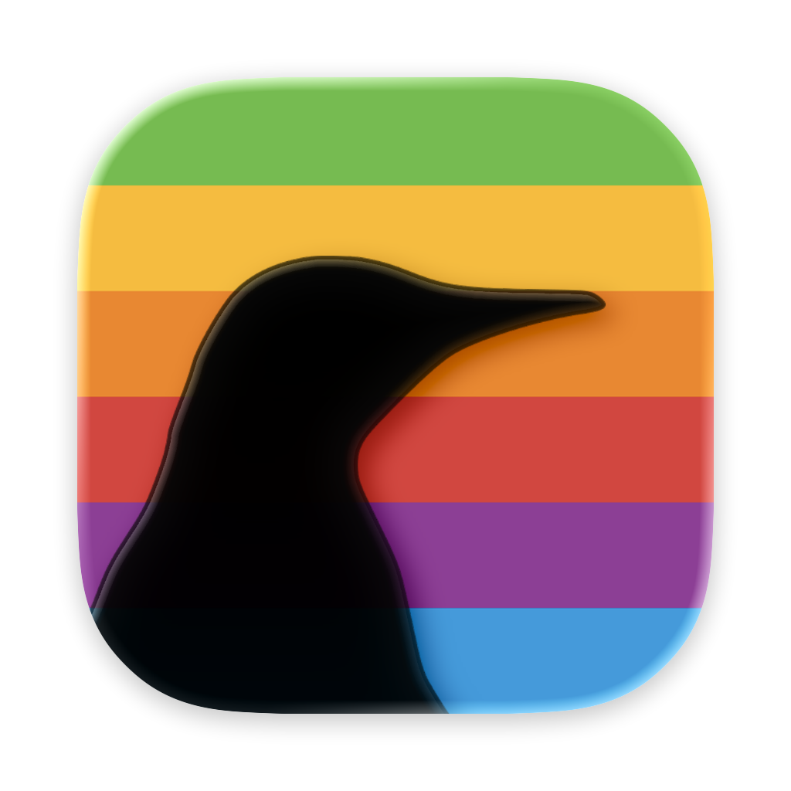

<p align="center">
  
</p>

<h1 align="center">Pingouin</h1>

<p align="center">experimental native-like linux vms on macos</p>

I recently stumbled upon _Try Omarchy_ and thought to myself, woa this is exactly what I wanted, if only it worked on any distro!\
So I took the patches and some of the ideas to make a new app :) \
You want to use linux as your main os but your mac isn't supported by Asahi yet? This is perfect for you!\
(You should also definitely consider [donating to Asahi](https://opencollective.com/asahilinux) if you can)

## Features

- **Run any arm linux distro** (Fedora, Ubuntu, Debian, Arch, NixOS…)!
- **Fast graphics**: OpenGL and Vulkan in Linux, on your Mac's GPU (virgl and Venus over MoltenVK).
- **120 Hz**, and full screen **over the notch** (the whole panel).
- **Trackpad gestures**: three- and four-finger swipes and pinches reach Linux as a real touchpad's.
- **⌘ shortcuts**: in full screen, ⌘ goes to Linux (as Super). that means you can use ⌘+q to open as many terminals as you want in your hyprland rice without quitting the app or use three finger swipe gestures in gnome/kde/niri/... ! Just press **⌃⌥Esc** and you're back with macos.
- **Extra displays**: In full screen, your other monitors can be Linux screens too!
- **Clipboard** sharing both ways, and **Paste as Typing** for places without a clipboard.
- **Shared folder**: a Mac folder shows up as `~/Mac` in Linux.

## Requirements

- A Mac with Apple Silicon (M1 or newer)
- macOS 15 Sequoia or newer
- An **ARM64 (aarch64)** Linux installer ISO, e.g. [Fedora Workstation](https://fedoraproject.org/workstation/download)

## Install

1. Download `Pingouin-<version>.dmg` from the [latest release](https://github.com/espcaa/pingouin/releases/latest).
2. Open it and drag **Pingouin** to **Applications**.
3. Open Pingouin. macOS will say it can't verify the developer: Pingouin isn't
   signed with a paid Apple Developer ID. Click **Done**, then go to
   **System Settings → Privacy & Security**, scroll down, and click
   **Open Anyway** next to Pingouin.

## First run

1. **Permissions.** Pingouin asks for **Accessibility** and **Input Monitoring**:
   that's how trackpad gestures and ⌘ shortcuts reach Linux. Click the two
   _Allow_ buttons in Pingouin's window and turn Pingouin on in each list.
2. **Make a VM.** **New VM** (⌘N): a name, CPUs, memory and disk size.
3. **Install Linux.** **Boot Installer ISO…** and pick your ISO. Install as
   usual, then shut down the vm & start it.
4. **Install the guest tools** (gestures, ⌘ shortcuts, displays, clipboard,
   shared folder). In a terminal inside Linux:

   ```sh
   sudo mkdir -p /mnt && sudo mount -t 9p -o trans=virtio,ro pingouin-tools /mnt && sudo bash /mnt/install.sh; sudo umount /mnt
   ```

   The VM's page in Pingouin has a **Copy** button for it, and tells you when
   the tools are installed or need an update. Log out and back in afterwards.
   We even have a module for nixos!

## Using it

|           |                                                                                            |
| --------- | ------------------------------------------------------------------------------------------ |
| **⌃⌥Esc** | in full screen: hand the keyboard and trackpad back to macOS (then swipe to another Space) |
| **⌃⌥D**   | in full screen: use the display under the pointer for Linux, or stop using it              |
| **⌃⌥V**   | type the Mac's clipboard into the VM (works anywhere, even at boot)                        |
| **⌘N**    | new VM                                                                                     |

- **Displays**: a VM starts on its _Start on_ display (optionally in full
  screen). In full screen, the others can be Linux screens: _Auto connect_ uses
  one every time, the switch uses it now. Arrange them in macOS's System
  Settings → Displays; Linux follows.
- **Vulkan** needs Mesa 26.2.4 or newer in Linux (OpenGL works either way).

## Building from source

You need Xcode's command-line tools, Go, and `pkg-config` (`brew install pkgconf`).

```sh
runtime/build.sh          # the patched QEMU runtime (~10 min the first time)
app/scripts/bundle.sh     # dist/Pingouin.app (also builds the guest tools)
```

To keep macOS's permissions across rebuilds, sign your builds with a
self-signed certificate: `app/scripts/make-dev-cert.sh "Your Name"` once.

Releases: `app/scripts/release.sh` locally, or push a `v*` tag and GitHub
Actions builds, signs and publishes it (see `.github/workflows/release.yml`).

## Credits

Pingouin started from [OmacVM](https://github.com/gillesgoetsch/omacvm) by
Gilles Goetsch and Try Omarchy, whose QEMU patches it builds on (MIT). \
QEMU is GPL-2.0; see [THIRD_PARTY_NOTICES.md](THIRD_PARTY_NOTICES.md) for
everything Pingouin includes. \
The penguin used in Pingouin's icon is from PhyloPic, by [Alexandre Vong](https://www.phylopic.org/images/4c20cc68-1acd-4c5a-adfe-86a61609748b/aptenodytes-patagonicus)

## License

Pingouin's own code (the app, the guest tools, the build scripts) is under the
[MIT License](LICENSE).\
The QEMU patches in `runtime/patches/` are GPL-2.0, like
QEMU itself, and the runtime Pingouin ships (QEMU, virglrenderer, MoltenVK…)
keeps each project's license: see [THIRD_PARTY_NOTICES.md](THIRD_PARTY_NOTICES.md).
